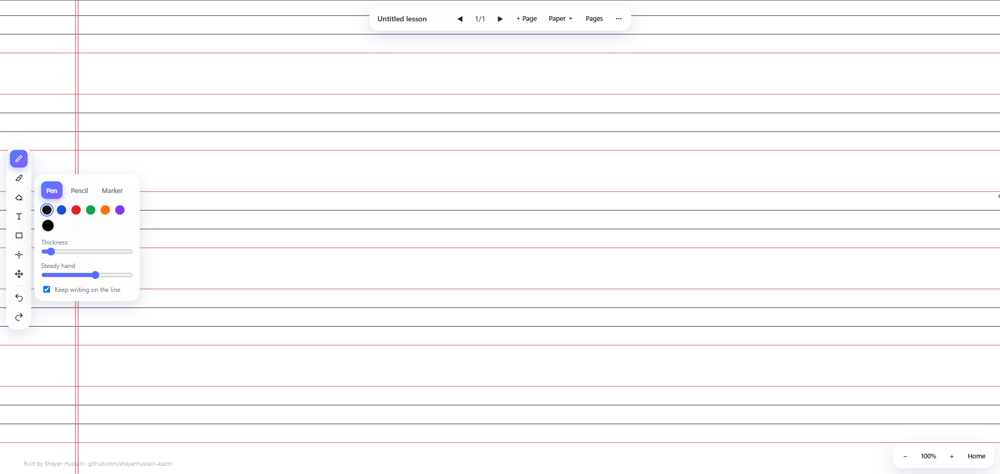

# Teaching Whiteboard

A free, offline-first digital whiteboard for teachers who teach online with a pen tablet. It feels like writing in a real school notebook: choose the paper (four-line, single-line, graph, Urdu and more), write naturally, add pages, and export the whole lesson as a PDF.

**Live app:** https://shayanhussain-kazmi.github.io/teaching-whiteboard/

## Why this exists

My mother teaches students online using a Huion pen tablet. The online whiteboards she was using had no notebook paper, expired boards, and pushed accounts and subscriptions. This app runs entirely in the browser, needs no sign-up, and keeps lessons on the teacher's own computer.

## Features

- **Infinite board:** pan and zoom in any direction; the paper is drawn wherever you look.
- **Notebook paper:** four-line (matching a real school copy), four-line dotted, single, double, interleaf, left/right margin, Urdu, Arabic, small/large/major graph, dotted, blank, and customisable ruled paper. Line spacing, line colour, paper colour and margin are adjustable per page.
- **Writing tools:** pen, pencil, marker, highlighter, laser pointer, text, and shapes (line, rectangle, ellipse, triangle, arrow).
- **Natural handwriting:** Pointer Events with pressure support, coalesced events for smooth fast strokes, an adjustable steady-hand stabiliser, and an optional "keep writing on the line" assist for ruled paper.
- **Eraser:** removes whole strokes; undo/redo on every page.
- **Pages:** add, duplicate, delete, reorder by dragging thumbnails, and use a different paper on each page.
- **Saves automatically** in the browser (IndexedDB). Open, rename and start lessons from the menu.
- **Export:** current page as PNG, whole lesson as a multi-page PDF.
- **Installable and offline:** works as a Progressive Web App.
- **Clean screen:** press `H` or `X` to hide every panel and show only the board.

## Install it like an app

1. Open the live link in **Microsoft Edge** or **Google Chrome**.
2. Click the **Install** icon in the address bar (or the browser menu: *Apps / Install page as app*).
3. Pin it to the taskbar. After the first visit it also opens without internet.

## Pen tablet setup (Huion and similar)

For pressure sensitivity, enable **Windows Ink** in the tablet driver settings. Browsers do not receive pressure from the older WinTab mode.

## Keyboard shortcuts

| Key | Action |
| --- | --- |
| `P` / `N` / `M` / `U` | Pen / Pencil / Marker / Highlighter |
| `E` | Eraser |
| `L` | Laser pointer |
| `T` | Text |
| `Space` (hold) | Pan the board |
| `H` or `X` | Hide / show all tools |
| `Ctrl+Z` / `Ctrl+Y` | Undo / Redo |
| `PageUp` / `PageDown` | Previous / next page |
| `+` / `-` / `0` | Zoom in / out / back to start |

## How it works

- Everything drawn is stored as **vector data** (points, pressure, colour, width), not pixels, so zooming stays sharp and erasing whole strokes is possible.
- **Paper is separate from ink.** Each template is a small function that draws vector lines for the visible area only, which is what makes the board infinite.
- The app is a single `index.html` with no frameworks and no build step. A service worker caches it for offline use.

## Known limitations

- No selection, lasso or image insertion yet.
- PDF export is made of high-resolution page images, so text inside it can't be selected.
- Lessons are stored in the browser on one computer. Clearing site data deletes them, so export important lessons as PDF.
- Pressure depends on the tablet driver (see above).

## Run it locally

Download the files and open `index.html` in Chrome or Edge. The installable offline mode needs the files served over `https://` (for example GitHub Pages).

## Author

Built by **Shayan Hussain**

- GitHub: https://github.com/shayanhussain-kazmi
- LinkedIn: https://www.linkedin.com/in/shayan-hussain51214/
